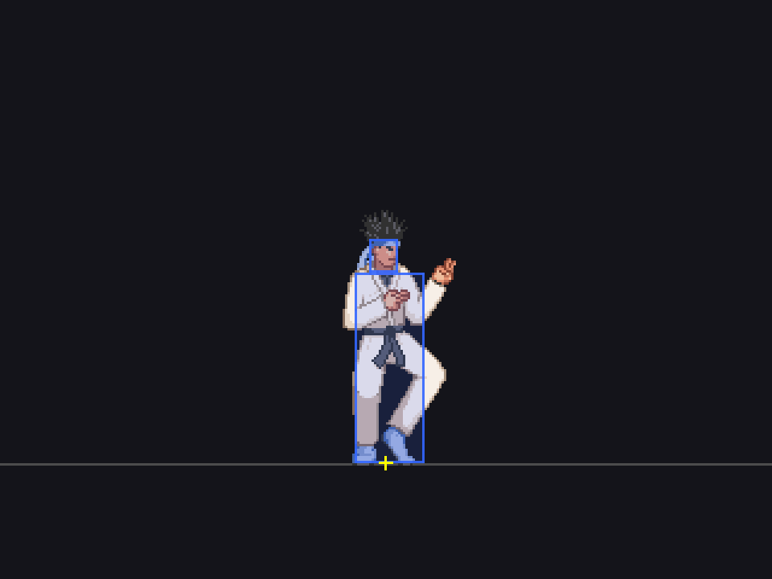

# Kung Fu Man

**Kung Fu Man (KFM)** is Elecbyte's example character, shipped with every
M.U.G.E.N release since 1999 and used by the [rugen](https://rugen.dev) docs as
the reference fighter (its power score defines 100 on the fairness scale). This
repository packages the classic M.U.G.E.N 1.1 version so it can be the first
entry of the [rugen fighter catalogue](https://rugen.dev/fighters) and the
sample for the [character template](https://github.com/rugen-dev/rugen-char-template).



KFM is (c) 2009 Elecbyte, released under the Creative Commons Noncommercial
license (attribution optional). Nothing here is ours: this repository only
adds a `rugen.json` manifest, the catalogue layout and a release workflow.

## Play

Download the zip from the [latest release](https://github.com/rugen-dev/kfm/releases/latest)
and drop it into rugen's `chars/` folder. Nothing to extract: rugen converts
zips on launch.

## Layout

```
kfm/            the character folder (def, cns, cmd, air, sff, snd, storyboards)
rugen.json      catalogue manifest (name, style, screenshots)
screenshots/    pictures the catalogue shows
LICENSE         CC-BY-NC, Elecbyte's terms
```

Controls and move list: see `kfm/readme.txt`.
